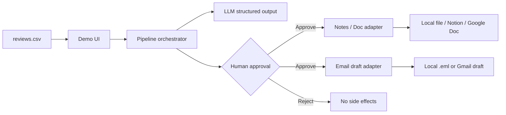
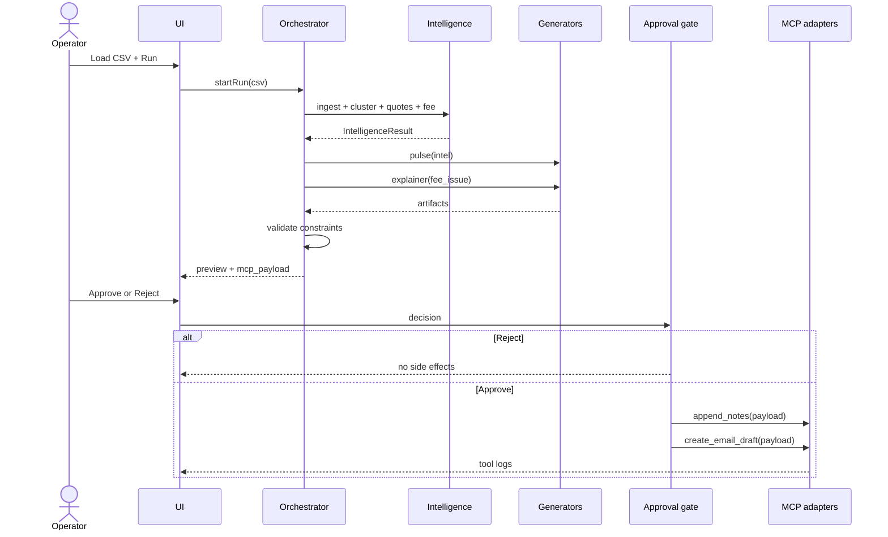

# Architecture: Review Insights (Groww)

**Product:** Review Insights  
**Audience:** Class demo prototype  
**Source:** `doc/PRD.md`  
**Last updated:** 2026-10-15

This document describes a **demo-sized** architecture: one CSV in, structured insights + two artifacts out, then **human-approved** writes to a notes doc and an email draft. No scraping, no auto-send, no auth.

---

## 1. Design goals

| Goal | How architecture supports it |
| --- | --- |
| Traceable insights | Quotes and fee issue stay bound to CSV row ids through the pipeline. |
| Controlled generation | Dedicated generators with hard constraints (≤250 words, ≤6 bullets, ≤5 themes). |
| Insight → communication | Fee explainer consumes **only** the fee issue from review intelligence, not a canned prompt. |
| Safety | MCP adapters are unreachable until an explicit Approve. Reject is a no-op. |
| Demo in ≤3 minutes | Single local UI, one Run button, one Approve step, visible tool logs. |
| Fallback | If real Gmail/Docs/Notion are unavailable, file-backed MCP adapters still complete the demo. |

---

## 2. System context



**Actors:** demo operator (student). Product and Support personas are *consumers of artifacts*, not logged-in users.

**External systems (optional for live MCP):** LLM API, Notion or Google Docs, Gmail. **Required for demo:** filesystem + LLM (or mocked LLM).

---

## 3. Logical architecture

Four layers. The UI never calls the LLM or MCP tools directly except through the orchestrator.

```text
┌─────────────────────────────────────────────────────────┐
│  Presentation                                            │
│  3-step wizard: Load → Insights → Approve MCP            │
└───────────────────────────┬─────────────────────────────┘
                            │ HTTP / in-process
┌───────────────────────────▼─────────────────────────────┐
│  Orchestration                                           │
│  RunPipeline → ValidateArtifacts → BuildMcpPayload       │
│  Approve / Reject                                        │
└─────────────┬───────────────────────────────┬───────────┘
              │                               │
┌─────────────▼─────────────┐   ┌─────────────▼───────────┐
│  Intelligence + Generate  │   │  MCP adapters           │
│  Cluster → Rank → Quotes  │   │  (gated)                │
│  Fee detect               │   │  append_notes           │
│  Pulse writer             │   │  create_email_draft     │
│  Explainer writer         │   └─────────────────────────┘
└─────────────┬─────────────┘
              │
┌─────────────▼─────────────┐
│  Data                     │
│  CSV store, run state,    │
│  audit log, output files  │
└───────────────────────────┘
```

---

## 4. Pipeline stages

One **run** is the unit of work. Stages are sequential; later stages only read the previous stage’s typed output.

| Stage | Responsibility | PRD IDs |
| --- | --- | --- |
| **1. Ingest** | Parse CSV; keep `review_id`, text, rating, date, source. Drop empty text. | RI-1 |
| **2. Review intelligence** | Cluster ≤5 themes; rank top 3; pick 3 quotes with source ids; detect 1 fee confusion or empty. | RI-2–RI-6 |
| **3. Weekly pulse** | Generate ≤250-word MD: themes, quotes, key observation, 3 actions. | WP-1–WP-3 |
| **4. Fee explainer** | If fee issue exists: ≤6 facts-only bullets, 2 official URLs, `Last checked:`. Else skip + empty state. | FE-1–FE-4 |
| **5. Constraint check** | Count words/bullets/themes; fail visible + allow retry. | §8 UX |
| **6. Preview** | Show artifacts + proposed MCP payload. **No writes.** | MCP-1 |
| **7. Gate** | Approve → adapters; Reject → stop. | MCP-1, MCP-5 |
| **8. MCP** | `append_notes` then `create_email_draft`. Log each result. | MCP-2, MCP-3 |

Fee explainer **must not** run from a hardcoded scenario. Its only fee input is stage 2.



---

## 5. Components

### 5.1 Demo UI

3-step wizard (PRD §8):

1. **Load** — use shipped sample CSV or upload; Run analysis.  
2. **Insights** — themes, top 3, quotes, fee issue (or empty state), pulse card (word count), explainer card (bullet count), MCP payload preview.  
3. **Approve** — Approve / Reject; then adapter success/failure logs.

No auth. Single-operator, single active run.

### 5.2 Orchestrator

Holds **run state** in memory (plus a JSON file for demo persistence):

- `run_id`, `status` (`ingesting` → `ready_for_approval` → `approved` | `rejected` | `failed`)
- `intelligence`, `weekly_pulse`, `fee_explainer`, `mcp_payload`
- `tool_logs[]`

Rules:

- MCP methods are not registered until `status === ready_for_approval`.
- Approve is idempotent: a second approve does not double-append (store `mcp_committed_at`).

### 5.3 Review intelligence

**Default (PRD §13):** LLM-assisted clustering on the sample CSV. No embedding infra required.

Suggested approach for demo quality:

1. Batch reviews (or a stratified sample if the file is large) into the model with a **JSON schema**.
2. Ask for ≤5 theme labels, membership or counts, top 3, three **verbatim** quotes with `review_id`.
3. Ask for at most one `fee_issue` with `evidence_review_id`; if none, `fee_issue: null`.
4. **Server-side verify:** quote text is a substring of the cited review; otherwise drop/replace.

Optional later: embeddings + k-means; not needed for class.

### 5.4 Generators

Two prompts, two schemas:

| Generator | Inputs | Outputs | Guards |
| --- | --- | --- | --- |
| Pulse writer | top 3 themes, quotes, fee_issue | markdown, word_count | regenerate if word_count > 250 |
| Explainer writer | fee_issue only + allowlisted official URLs | bullets, source_links, last_checked | max 6 bullets; require 2 links; facts-only instruction |

`last_checked` is set by the orchestrator (run date), not the model.

Official links should come from a small **source allowlist** in config (Groww help / regulator pages), not hallucinated URLs. The model may *choose* 2 from the list that match the fee.

### 5.5 Approval gate

The gate is a first-class component, not a CSS button on a live tool:

```text
if decision != APPROVE: return
if run.status != ready_for_approval: reject
lock run
append_notes(payload)
create_email_draft(payload)
record logs
mark approved
```

UI copy must make the side effects obvious before click.

### 5.6 MCP adapters

Same interface whether backends are real or simulated (PRD MCP-4):

```text
append_notes(payload) -> { ok, location, error? }
create_email_draft(payload) -> { ok, location, error? }
```

**Payload (PRD MCP-2):**

```json
{
  "date": "YYYY-MM-DD",
  "top_themes": ["...", "...", "..."],
  "weekly_pulse": "...",
  "identified_fee_issue": "...",
  "explanation_bullets": ["...", "..."],
  "source_links": ["https://...", "https://..."]
}
```

| Adapter | Demo default | Live option |
| --- | --- | --- |
| Notes | Append Markdown/JSON block to `output/notes.md` | Notion page or Google Doc |
| Email | Write `output/email-draft.md` (subject + body); **never send** | Gmail API `drafts.create` |

Email subject: `Weekly Product Pulse + Customer Clarification — {date or fee name}`.  
Body: weekly pulse + fee snippet.

If one adapter fails, log it; do not silently skip. Retry from UI is allowed; idempotency key = `run_id`.

---

## 6. Data model

### 6.1 Input (CSV)

| Field | Required | Notes |
| --- | --- | --- |
| `review_id` | yes (or synthesize row index) | Traceability |
| `text` | yes | Clustering + quotes |
| `rating` | no | Ranking / pulse |
| `date` | no | 8–12 week window display |
| `source` | no | Play / App Store |

### 6.2 In-run objects

Aligns with PRD §7:

```text
Review { id, text, rating?, date?, source? }
Theme { name, summary, review_count, review_ids[] }
IntelligenceResult {
  themes[≤5],
  top_themes[3],
  quotes[3] { text, review_id, date?, rating? },
  fee_issue: null | { name, why_confused, evidence_quote, evidence_review_id }
}
WeeklyPulse { markdown, word_count }
FeeExplainer { bullets[≤6], source_links[2], last_checked }
McpPayload { date, top_themes, weekly_pulse, identified_fee_issue, explanation_bullets, source_links }
ToolLog { tool, ok, location?, error?, at }
Run { id, status, intelligence, pulse, explainer, payload, logs }
```

### 6.3 Persistence (demo)

| Store | What |
| --- | --- |
| `data/reviews.csv` | Sample input |
| `output/runs/{run_id}.json` | Full run snapshot |
| `output/weekly-pulse.md` | Deliverable export |
| `output/notes.md` | Append-only MCP notes |
| `output/email-draft.md` | MCP email draft |
| `config/sources.json` | 4–6 official URLs (assignment source list) |

No database.

---

## 7. Suggested repo layout

```text
review-insights/
  doc/PRD.md
  doc/architecture.md
  data/reviews.csv
  config/sources.json
  src/
    ui/                 # wizard
    orchestrator.py     # or ts equivalent
    intelligence/
    generate/
    mcp/
      gate.py
      notes.py
      email_draft.py
    models.py
  output/
  README.md
```

Stack default: **Python (FastAPI or Streamlit) + one LLM with JSON mode**, or a small Next.js app with a thin API. Prefer whichever is faster to demo; architecture stays the same.

---

## 8. Trust, constraints, failure modes

| Concern | Handling |
| --- | --- |
| Invented quotes | Verify quote ⊆ cited review text. |
| Invented fee | `fee_issue` may be null; UI empty state; explainer + fee fields omitted from MCP or marked `none`. |
| Hallucinated URLs | Allowlist in `config/sources.json`. |
| Over-long pulse | Validator rejects; one automatic regenerate; then surface error. |
| Accidental send | Email adapter has **no send method**. |
| Accidental write | Adapters not invoked without gate token / approved status. |
| LLM timeout | Run `failed`; keep CSV loaded; retry Run. |
| Partial MCP | Show which tool succeeded; retry failed tool with same `run_id`. |

---

## 9. Demo path (what to show)

1. Load sample CSV → Run.  
2. Point at top 3 themes, 3 quotes, **fee grounded in a quote**.  
3. Show pulse word count and explainer bullets.  
4. Open MCP payload → **Approve**.  
5. Open `output/notes.md` (appended block) and `output/email-draft.md` (or Gmail draft).  
6. Optional: second run with **Reject** to prove no write.

That sequence is the architecture’s success criterion, not a production SLA.

---

## 10. Explicitly not in this architecture

Live store scrapers, cron, user accounts, CRM, multi-fee explainers, production secret management beyond a local `.env` for the LLM (and optional Gmail/Notion).
